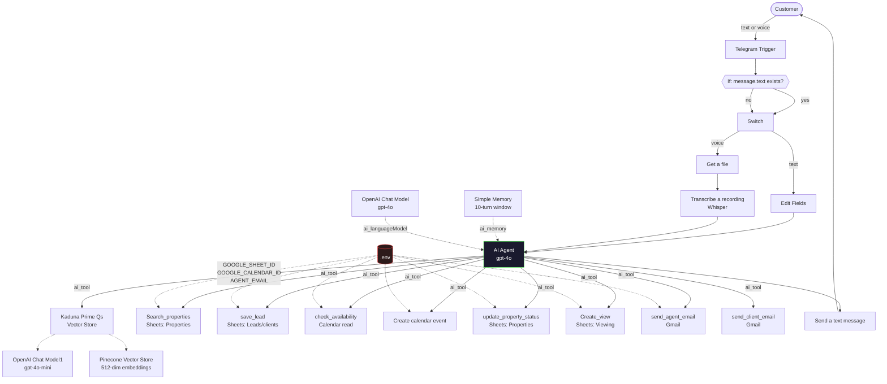
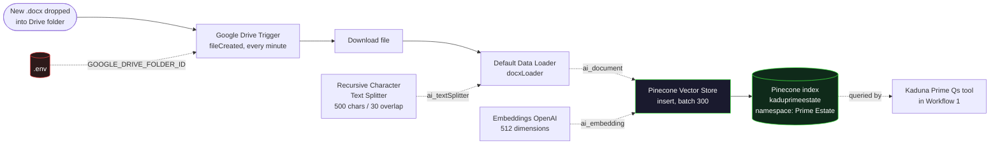

# Kaduna Prime Estate — AI Property Assistant

An intelligent, voice-and-text conversational agent that acts as the 24/7 front desk for a
real estate company in Kaduna, Nigeria. It answers questions, searches live property listings,
qualifies and captures leads, books viewings to a shared calendar, and hands off to a human
agent when it needs to.

Built with [n8n](https://n8n.io) as a **two-workflow system**:

| Workflow | File | Role |
|---|---|---|
| **AI Property Assistant** | `workflows/kaduna-prime-estate.json` | The customer-facing agent. Telegram in, grounded answers and booked viewings out. |
| **RAG Ingestion** | `workflows/kaduna-prime-estate-rag-ingestion.json` | The knowledge pipeline. Drops documents into Google Drive, they are chunked, embedded and indexed into Pinecone automatically. |

[](https://n8n.io)
[](https://telegram.org)
[](https://openai.com)
[](https://sheets.google.com)
[](https://drive.google.com)
[](https://cloudinary.com)
[](https://pinecone.io)

---

## Table of Contents

- [What It Does](#what-it-does)
- [How It Works](#how-it-works)
- [Architecture](#architecture)
- [Workflow 1 — AI Property Assistant](#workflow-1--ai-property-assistant)
- [Workflow 2 — RAG Ingestion](#workflow-2--rag-ingestion)
- [The Agent's Tools](#the-agents-tools)
- [Property Images (Cloudinary)](#property-images-cloudinary)
- [Tech Stack](#tech-stack)
- [Repository Structure](#repository-structure)
- [Setup](#setup)
  - [1. Prerequisites](#1-prerequisites)
  - [2. Environment Variables](#2-environment-variables)
  - [3. Google Sheets Database](#3-google-sheets-database)
  - [4. Google OAuth Credentials](#4-google-oauth-credentials)
  - [5. Google Drive Knowledge Folder](#5-google-drive-knowledge-folder)
  - [6. Telegram Bot](#6-telegram-bot)
  - [7. OpenAI](#7-openai)
  - [8. Pinecone Knowledge Base](#8-pinecone-knowledge-base)
  - [9. Import the Workflows](#9-import-the-workflows)
  - [10. Attach Credentials](#10-attach-credentials)
  - [11. Run It](#11-run-it)
- [Configuration Reference](#configuration-reference)
- [Security](#security)
- [Testing](#testing)
- [Troubleshooting](#troubleshooting)
- [Known Limitations](#known-limitations)
- [Roadmap](#roadmap)
- [Author](#author)
- [License](#license)

---

## What It Does

Together these two workflows turn a Telegram bot into a fully qualified real estate assistant
with a self-maintaining knowledge base.

| Capability | Detail | Workflow |
|---|---|---|
| **Text chat** | Natural-language conversation in English or Hausa, memory-backed per chat. | 1 |
| **Voice notes** | Receives Telegram voice messages, transcribes them with Whisper, and replies as text. | 1 |
| **Knowledge base** | Answers company, policy, payment-plan and FAQ questions from a Pinecone vector store — grounded, never invented. | 1 |
| **Self-updating knowledge** | Drop a `.docx` into a Drive folder and it is chunked, embedded and indexed automatically. | 2 |
| **Property search** | Queries a live Google Sheet and returns type, location, price, size, bedrooms, features and images. | 1 |
| **Photo delivery** | Shares Cloudinary image links from the `Images` column so customers can click through to the photos. | 1 |
| **Lead capture** | Collects name, phone, email, budget, location and intent, then writes a structured lead row with an auto-generated ID. | 1 |
| **Viewing bookings** | Checks calendar availability, creates the event, logs the viewing, flips the property status, emails the agent and emails the customer a confirmation. | 1 |
| **Human handoff** | Escalates to a human agent for negotiation, complaints, or anything outside its scope. | 1 |

### Conversation flow

```
Customer (text or voice)
        |
        v
  Telegram Trigger
        |
   Is it text?
    /        \
  yes         no
   |           |
   v           v
 Edit Fields   Get a file --> Transcribe (Whisper)
   |           |                |
   +-----------+----------------+
        |
        v
    AI Agent  (gpt-4o + 10-message memory + 9 tools)
        |
        v
  Send a text message  -->  Customer
```

---

## How It Works

1. **Trigger** — `Telegram Trigger` receives every incoming message update.
2. **Routing** — an `If` node checks whether `message.text` exists, then a `Switch` node splits
   the conversation into two paths: `text` and `voice`.
3. **Voice handling** — on the voice path, `Get a file` downloads the audio and
   `Transcribe a recording` (OpenAI Whisper) converts it to text.
4. **Normalisation** — both paths converge on a single text field the agent can reason about.
5. **Agent** — the `AI Agent` node runs a `gpt-4o` chat model with a `Simple Memory`
   (10-turn window) keyed on the Telegram `chat.id`, so each customer keeps an isolated
   conversation history.
6. **Tool use** — the agent decides which tools to call: vector search, Sheets read/write,
   Calendar read/write, or Gmail.
7. **Reply** — the agent's `output` is sent back to the same chat via `Send a text message`.

---

## Architecture



---

## Workflow 1 — AI Property Assistant

`workflows/kaduna-prime-estate.json` — 24 nodes. This is the customer-facing agent and the main
event of the project. Its flow is described in [How It Works](#how-it-works) above, and the nine
tools it can call are listed in [The Agent's Tools](#the-agents-tools).

---

## Workflow 2 — RAG Ingestion

`workflows/kaduna-prime-estate-rag-ingestion.json` — 6 nodes. This is the knowledge pipeline that
keeps the agent's answers accurate. Without it, the Pinecone index has to be populated by hand.

### How ingestion works

1. **`Google Drive Trigger`** watches a single Drive folder and fires on the `fileCreated` event,
   polling once per minute.
2. **`Download file`** fetches the binary content of the newly created file.
3. **`Default Data Loader`** parses the binary as a `.docx` document and hands the raw text to the
   splitter.
4. **`Recursive Character Text Splitter`** cuts the text into **500-character chunks with a
   30-character overlap**, so a sentence spanning a chunk boundary still appears whole in one of
   them.
5. **`Pinecone Vector Store`** embeds each chunk with OpenAI (**512 dimensions**) and upserts the
   vectors into the `kaduprimeestate` index under the `Prime Estate` namespace, in batches of 300.

### Flow



> **Both workflows share one Pinecone index.** Workflow 2 writes into it; Workflow 1 reads from it
> through the `Kaduna Prime Qs` tool. Index name, namespace and embedding dimensions **must** stay
> identical across both, or retrieval silently returns nothing.

### Operational notes

| Concern | Detail |
|---|---|
| **Supported format** | `.docx` only, because the data loader is set to `docxLoader`. A PDF will fail to parse. |
| **Polling cost** | `everyMinute` means 1,440 Drive API list calls per day. Consider `everyXMinutes` at 5–10 for a smaller quota footprint. |
| **No deduplication** | Re-uploading a corrected file adds new vectors. The old chunks stay and can still surface. Delete the namespace and re-ingest when a document changes materially. |
| **No error routing** | A failed parse stops that execution only. Watch the execution log when a document does not appear in search results. |

---

## The Agent's Tools

The AI Agent has access to nine tools. Each is a real n8n node, so every action is visible,
debuggable and auditable in the n8n UI.

| Tool | Backing service | Action |
|---|---|---|
| `Kaduna Prime Qs` | Pinecone + OpenAI | Answers company, policy, payment and FAQ questions from the approved knowledge base. |
| `Search_properties` | Google Sheets → `Properties` | Looks up listings and returns full details plus images. |
| `save_lead` | Google Sheets → `Leads/clients` | Appends a new lead with an auto-generated `lead_id` (`BNC` + timestamp). |
| `check_availability` | Google Calendar | Reads booked events between a requested start and end. |
| `Create an event in Google Calendar` | Google Calendar | Books the viewing and invites the agent. |
| `update_property_status` | Google Sheets → `Properties` | Matches on `property_id` and sets `status` (e.g. `Under Offer`). |
| `Create_view` | Google Sheets → `Viewing` | Logs the booking with customer, property, time and calendar event ID. |
| `send_agent_email` | Gmail | Notifies the assigned agent about a new lead or booking. |
| `send_client_email` | Gmail | Sends the customer their booking summary. |

### Guardrails encoded in the system prompt

- Only shares properties marked **available**.
- **Never invents** prices, availability, policies or details — defers to an agent instead.
- **No negotiation**, discounting, or legal/financial advice.
- **Never discloses** other clients' data or internal agent details beyond a name and role.
- Requires **name + phone before booking**, and only confirms a booking after the calendar
  event is successfully created.
- Keeps replies short (2–4 sentences) and mirrors the customer's language.

---

## Property Images (Cloudinary)

Property photos are hosted on [Cloudinary](https://cloudinary.com) and referenced from the
`Images` column of the `Properties` tab. The agent never uploads or serves images itself — it
reads the URLs from the spreadsheet and shares them in the conversation, so a customer can click
straight through to the photos.

### How it fits together

```
Agent room --> Google Sheets (Images column) --> Cloudinary delivery URL --> Customer
```

1. Upload the property photos to your Cloudinary account (Media Library, dashboard drag-and-drop,
   or the [Cloudinary CLI](https://cloudinary.com/documentation/media_libraries/how_to_use_cli/)).
2. Copy each asset's **delivery URL**.
3. Paste the URLs into the `Images` cell of that property's row, separated by commas.
4. The agent picks them up on the next `Search_properties` call and shares them.

### Populating the `Images` cell

| Goal | Value to paste |
|---|---|
| One photo | `https://res.cloudinary.com/<cloud>/image/upload/<public_id>.jpg` |
| Several photos | The same URLs separated by commas — `url1,url2,url3` |
| Customer-friendly size | Append a transform: `…/upload/w_1200,h_800,c_fill,q_auto,f_auto/<public_id>` |
| Lightweight thumbnail | `…/upload/w_400,h_300,c_thumb/<public_id>` |
| Blur-up placeholder | `…/upload/w_20,e_blur:2000,q_1,w_40,h_30,c_thumb/<public_id>` |

`f_auto` and `q_auto` let Cloudinary negotiate WebP/AVIF and compression per device, which matters
on mobile data in Nigeria.

### Handling images in the sheet

- Keep the **raw delivery URL**, not a local file path or a Drive link — Drive links require
  authentication and will not open for a customer.
- Leave the cell **empty** rather than pasting placeholder text. The system prompt tells the agent
  to say photos are available on request when no image is present.
- Prefer a consistent `w_` width so the agent's replies stay predictable.

> **Security**
> Only ever paste **public delivery URLs**. Never put your Cloudinary **API key**, **API secret**
> or **upload preset** secret into the spreadsheet, the workflow, or this repository. If you
> automate uploads later, put the credentials in `.env` (or better, n8n credentials) and never
> commit them.

### Known quirk to be aware of

The `Properties` tab column is named `Images`, while the system prompt instructs the agent to send
`image_url` from the database. If photos intermittently fail to appear, rename the sheet column to
`image_url` (or update the prompt to say `Images`) so both agree — see
[Troubleshooting](#troubleshooting).

---

## Tech Stack

| Layer | Technology |
|---|---|
| Orchestration | [n8n](https://n8n.io) |
| Channel | Telegram Bot API |
| Reasoning | OpenAI `gpt-4o` |
| Retrieval | Pinecone vector store + OpenAI embeddings (512 dimensions) |
| RAG sub-model | OpenAI `gpt-4o-mini` |
| Speech-to-text | OpenAI Whisper (`whisper-1`) |
| Database | Google Sheets (3 tabs) |
| Image hosting | [Cloudinary](https://cloudinary.com) — delivery URLs in the `Images` column |
| Documents | Google Drive folder (watched for new `.docx`) |
| Chunking | Recursive Character Text Splitter (500 / 30) |
| Calendar | Google Calendar |
| Email | Gmail |
| Memory | n8n Simple Memory (10-turn window) |
| Secrets | Environment variables (`.env`, git-ignored) |

---

## Repository Structure

```
.
├── .env.example                                     # Template for required environment variables
├── .gitignore                                       # Blocks secrets, n8n data and local noise
├── README.md                                        # This file
├── SECURITY.md                                      # Security policy and secret-handling rules
├── LICENSE                                          # Add before publishing (see License section)
└── workflows/
    ├── kaduna-prime-estate.json                     # Workflow 1 - AI Property Assistant (24 nodes)
    └── kaduna-prime-estate-rag-ingestion.json       # Workflow 2 - Drive to Pinecone ingestion (6 nodes)
```

> **Note**
> Your original working exports — `Kaduna Rime Estate.json` and `RAG APP.json` — stay on your
> machine and are git-ignored. They still contain your live credential bindings, your n8n
> instance ID and real customer data, so they must never be committed. The two files in
> `workflows/` are the sanitized, shareable equivalents.

---

## Setup

### 1. Prerequisites

- **n8n** v1.75+ (the `Tool` node variants used here require a recent version). Either
  [n8n Cloud](https://n8n.io) or a local instance via Docker or npm.
- A **Telegram bot** token from [@BotFather](https://t.me/BotFather).
- An **OpenAI API key** with access to `gpt-4o`, `gpt-4o-mini`, embeddings and Whisper.
- A **Pinecone** index.
- A **Cloudinary** account for hosting property photos (a free tier is enough to start).
- A **Google Cloud** project with the Sheets, Calendar **and Drive** APIs enabled, plus OAuth
  credentials.

### 2. Environment Variables

```bash
# Windows PowerShell
copy .env.example .env

# macOS / Linux
cp .env.example .env
```

Then edit `.env` and set:

```ini
GOOGLE_SHEET_ID=1AbCdEfGhIjKlMnOpQrStUvWxYz1234567890abcdef
GOOGLE_CALENDAR_ID=your-calendar-id@group.calendar.google.com
GOOGLE_DRIVE_FOLDER_ID=1XyZAbCdEfGhIjKlMnOpQrStUvWxYz
AGENT_EMAIL=agent@yourdomain.com
```

| Variable | Required by | Purpose |
|---|---|---|
| `GOOGLE_SHEET_ID` | Workflow 1 | Spreadsheet holding `Properties`, `Leads/clients` and `Viewing`. |
| `GOOGLE_CALENDAR_ID` | Workflow 1 | Calendar used for availability checks and bookings. |
| `AGENT_EMAIL` | Workflow 1 | Fallback agent inbox for notifications and calendar invites. |
| `GOOGLE_DRIVE_FOLDER_ID` | Workflow 2 | Drive folder watched for new knowledge-base documents. |

To find your spreadsheet ID, open the sheet in a browser and read the URL:

```
https://docs.google.com/spreadsheets/d/1AbCdEfGhIjKlMnOpQrStUvWxYz1234567890abcdef/edit#gid=0
                                                       └────────── this value ──────────┘
```

To find your Drive folder ID:

```
https://drive.google.com/drive/folders/1XyZAbCdEfGhIjKlMnOpQrStUvWxYz
                                         └────────── this value ──────────┘
```

> Docker Compose reads `.env` automatically. For a bare `n8n start` install, export the
> variables into your shell before launching n8n.

### 3. Google Sheets Database

Create one spreadsheet and give it three tabs with the exact names below — the workflow matches
tab names literally.

**Tab 1 — `Properties`**

| Column | Type | Notes |
|---|---|---|
| `property_id` | Text | Unique key, matched by `update_property_status`. |
| `property_name` | Text | |
| `property_type` | Text | e.g. Flat, Terrace, Bungalow. |
| `status` | Text | `Available`, `Under Offer`, `Sold`. Only `Available` is shared. |
| `listing_type` | Text | Sale / Rent. |
| `location` | Text | Area / estate. |
| `area` | Text | |
| `price` | Number | |
| `currency` | Text | e.g. `NGN`. |
| `bedrooms` | Number | |
| `bathrooms` | Number | |
| `parking_spaces` | Number | |
| `property_size_sqm` | Number | |
| `furnishing` | Text | |
| `estate` | Text | |
| `amenities` | Text | Comma-separated. |
| `description` | Text | Shown to the customer. |
| `suitable_for` | Text | e.g. Family, Investment. |
| `payment_plan` | Text | |
| `inspection_available` | Text | |
| `Images` | Text | **Cloudinary delivery URLs**, comma-separated. See [Property Images](#property-images-cloudinary). |
| `date_added` | Date | |
| `last_updated` | Date | |

**Tab 2 — `Leads/clients`**

`lead_id`, `full_name`, `phone_number`, `email`, `source`, `preferred_location`,
`property_type`, `bedrooms`, `bathrooms`, `budget`, `purpose`, `preferred_amenities`,
`property_of_interest`, `lead_status`, `lead_temperature`, `viewing_status`, `viewing_date`,
`viewing_time`, `conversation_summary`, `last_message`, `last_contacted`, `next_follow_up`,
`assigned_agent`, `created_at`, `updated_at`

**Tab 3 — `Viewing`**

`viewing_id`, `lead_id`, `property_id`, `customer_name`, `customer_phone`, `viewing_date`,
`viewing_time`, `status`, `calendar_event_id`, `notes`, `created_at`, `updated_at`

Add a header row to each tab. `lead_id` is generated automatically in the form
`BNC` + `yyMMddHHmmss`.

### 4. Google OAuth Credentials

1. In [Google Cloud Console](https://console.cloud.google.com/), create or select a project.
2. Enable the **Google Sheets API**, **Google Calendar API** **and Google Drive API**.
3. Configure the **OAuth consent screen** (add your e-mail as a test user).
4. Create an **OAuth Client ID** (type *Web application*).
5. In n8n, create these credentials and paste the client ID and secret:
   - `Google Sheets OAuth2 API`
   - `Google Calendar OAuth2 API`
   - `Google Drive OAuth2 API`
   - `Gmail OAuth2`
6. Share the spreadsheet, the calendar **and the Drive folder** with the Google account you
   authenticate with.

For headless or production deployments, a **service account** is the better option. Create a
service-account JSON key, share the spreadsheet, calendar and Drive folder with its
`client_email`, and point the n8n credentials at the JSON key.

### 5. Google Drive Knowledge Folder

Workflow 2 needs a dedicated Drive folder to watch.

1. Create a folder such as `Kaduna Prime Estate — Knowledge Base` in Google Drive.
2. Copy its ID from the URL and set `GOOGLE_DRIVE_FOLDER_ID` in `.env`.
3. Drop your company documents into it as **`.docx`** files. PDFs will not parse, because the data
   loader is configured for `docxLoader`.
4. Good candidates: payment-plan terms, viewing procedures, company profile, frequently asked
   questions, refund and allocation policy.

### 6. Telegram Bot

1. Message [@BotFather](https://t.me/BotFather) and send `/newbot`.
2. Choose a name and username, then copy the **bot token**.
3. In n8n, create a `Telegram account` credential and paste the token.
4. Open your bot in Telegram and send `/start` once so it can receive updates.

### 7. OpenAI

Create an `OpenAi account` credential in n8n with your API key. Both workflows use:

| Purpose | Model | Workflow |
|---|---|---|
| Agent reasoning | `gpt-4o` | 1 |
| Knowledge-base answers | `gpt-4o-mini` | 1 |
| Embeddings | OpenAI embeddings, **512 dimensions** | 1 and 2 |
| Transcription | `whisper-1` | 1 |

> Changing the embedding dimensions requires re-indexing your Pinecone index. Keep this at 512
> unless you rebuild the vector store, and update **both** workflows together.

### 8. Pinecone Knowledge Base

1. Create a Pinecone index and name it `kaduprimeestate`.
2. Use the namespace `Prime Estate`.
3. In n8n, create a `Pinecone account` credential.

Workflow 2 populates the index for you, so you do not need to embed anything by hand. Import and
activate it, drop a `.docx` into the Drive folder, and wait for the poll to pick it up.

### 9. Import the Workflows

1. In n8n, go to **Workflows → Import from File**.
2. Import `workflows/kaduna-prime-estate-rag-ingestion.json` **first**, so the index is populated.
3. Then import `workflows/kaduna-prime-estate.json`.
4. Both open with all credential slots intentionally empty.

### 10. Attach Credentials

The imported templates have **no credentials bound** — this is deliberate, so no secret ever
enters version control. Attach your own to each node.

**Workflow 1 — AI Property Assistant**

| Node | Credential to select |
|---|---|
| `Telegram Trigger` | Telegram account |
| `Get a file` | Telegram account |
| `Send a text message` | Telegram account |
| `Send an audio file` | Telegram account |
| `Transcribe a recording` | OpenAi account |
| `Generate audio` | OpenAi account |
| `OpenAI Chat Model` / `OpenAI Chat Model1` | OpenAi account |
| `Embeddings OpenAI` | OpenAi account |
| `Pinecone Vector Store` | Pinecone account |
| `Search_properties` | Google Sheets OAuth2 API |
| `save_lead` | Google Sheets OAuth2 API |
| `update_property_status` | Google Sheets OAuth2 API |
| `Create_view` | Google Sheets OAuth2 API |
| `check_availability` | Google Calendar OAuth2 API |
| `Create an event in Google Calendar` | Google Calendar OAuth2 API |
| `send_agent_email` | Gmail OAuth2 |
| `send_client_email` | Gmail OAuth2 |

### 11. Run It

Activate the workflows in this order:

1. **Workflow 2 (RAG Ingestion)** — click **Activate**, then drop a `.docx` into the Drive folder
   and confirm a successful Pinecone upsert in the execution log.
2. **Workflow 1 (AI Property Assistant)** — click **Test Workflow**, send a text message to your
   bot, and confirm the reply arrives.
3. Switch off test mode and click **Activate**.

Also fill in **Settings → Variables** in n8n if you prefer managing values there instead of
`.env`. Set `GOOGLE_SHEET_ID`, `GOOGLE_CALENDAR_ID`, `GOOGLE_DRIVE_FOLDER_ID` and `AGENT_EMAIL`
accordingly, then swap `$env.VAR` for `$vars.VAR` in the node expressions.

---

## Configuration Reference

| Setting | Default | Notes |
|---|---|---|
| Memory window | 10 messages | `Simple Memory` → `contextWindowLength`. |
| Memory session key | Telegram `chat.id` | Keeps each customer's history separate. |
| Embedding dimensions | 512 | Must match the Pinecone index. |
| Pinecone index | `kaduprimeestate` | Shared by both workflows. |
| Pinecone namespace | `Prime Estate` | Shared by both workflows. |
| Lead ID format | `BNC` + `yyMMddHHmmss` | Edit in the `save_lead` node. |
| Property status on booking | `Under Offer` | Set in the system prompt. |
| Reply attribution | Disabled | `appendAttribution: false`. |
| Email sender name | `Kaduna Prime Estate` | Set in `send_client_email`. |
| Image hosting | Cloudinary delivery URLs | Stored in the `Images` column of `Properties`. |
| Image link format | Comma-separated URLs | Multiple photos go in one cell, separated by commas. |
| Drive trigger event | `fileCreated` | Workflow 2. |
| Drive poll interval | Every minute | Workflow 2. Raise to 5–10 minutes to cut API quota usage. |
| Document loader | `docxLoader` | Workflow 2. `.docx` only. |
| Chunk size / overlap | 500 / 30 characters | Workflow 2. |
| Embedding batch size | 300 | Workflow 2. |
| Vector store mode | `insert` | Workflow 2. Writes are append-only — see limitations. |

---

## Security

This repository is designed to be safe to publish. Read [SECURITY.md](SECURITY.md) for the
full policy.

**What was removed from the published workflow templates:**

| Removed | Replaced with |
|---|---|
| All credential bindings (IDs and names) | Empty slots — you attach your own |
| Google Sheets document ID | `$env.GOOGLE_SHEET_ID` |
| Google Calendar ID | `$env.GOOGLE_CALENDAR_ID` |
| Google Drive folder ID | `$env.GOOGLE_DRIVE_FOLDER_ID` |
| Agent e-mail addresses | `$env.AGENT_EMAIL` |
| Personal phone number and agent name in the prompt | Read from the database at runtime |
| n8n `instanceId` | Removed |
| Webhook path tokens | Removed |
| Pinned execution data | Cleared |
| Cached Google resource URLs and labels | Removed or replaced with safe labels |

The two original exports in your project root are git-ignored, so `git add .` will never stage
them.

**Rules for contributors:**

- Never commit `.env`. Only `.env.example` belongs in version control.
- Export from n8n using **Download**, then strip credentials before sharing any export.
- Run `git status` and `git diff --staged` before every commit.
- Treat customer phone numbers and e-mail addresses as personal data — never commit live
  exports of the `Leads/clients` tab.

---

## Testing

### Workflow 2 — RAG Ingestion

1. **Ingestion** — drop a `.docx` into the watched Drive folder, wait one poll cycle, and confirm
   the execution log shows a successful Pinecone upsert.
2. **Retrieval** — ask the bot a question whose answer is unique to that document and confirm it
   replies with the correct content.
3. **Negative control** — ask about something not in any document and confirm the agent says it
   does not have the information.
4. **Format guard** — drop a PDF and confirm it fails to parse, so you know the limitation before
   a customer document hits the folder.

### Workflow 1 — AI Property Assistant

1. **Text Q&A** — ask *"What are your office hours?"* and confirm the answer comes from the
   knowledge base rather than being invented.
2. **Property search** — ask *"Show me 3-bedroom flats in Kakuri"* and confirm live data.
3. **Lead capture** — ask about a property and provide a name and phone; confirm a row lands in
   `Leads/clients` with a generated `lead_id`.
4. **Voice** — send a Telegram voice note and confirm transcription plus reply.
5. **Booking** — request a viewing and confirm the calendar event, the `Viewing` row, the
   `status` change to `Under Offer`, and both e-mails.
6. **Guardrail** — ask *"Can you knock off 500k?"* and confirm it declines and escalates.
7. **Memory** — confirm the agent remembers context across several messages in the same chat.
8. **Images** — ask about a property that has Cloudinary URLs in its `Images` cell and confirm the
   reply contains clickable links. Then test a property with an empty `Images` cell and confirm the
   agent says photos are available on request instead of inventing a link.

Use a **Telegram test group** rather than your live customer channel while testing.

---

## Troubleshooting

| Symptom | Fix |
|---|---|
| Bot does not respond | Send `/start` to the bot, then confirm the workflow is **Active** and the Telegram credential is attached. |
| `$env.VAR` comes back empty | `N8N_BLOCK_ENV_ACCESS_IN_NODE` must be `false`. Alternatively define the value under **Settings → Variables**. |
| Sheet tab not found | Tab names are case-sensitive and must match exactly, including the slash in `Leads/clients`. |
| Pinecone returns nothing | Check the index name, the namespace `Prime Estate`, and that embeddings use 512 dimensions in **both** workflows. |
| Calendar permission error | Share the calendar with the authenticated account or service account. |
| Drive trigger never fires | Confirm `GOOGLE_DRIVE_FOLDER_ID` is set, the folder is shared with the authenticated account, and Workflow 2 is **Active**. |
| Document fails to parse | The loader accepts `.docx` only. Re-save as `.docx` or switch the loader to `pdfLoader`. |
| Old answers keep appearing | Vectors are append-only. Delete the `Prime Estate` namespace and re-ingest the corrected document. |
| Drive quota errors | Lower the poll frequency from `everyMinute` to `everyXMinutes`. |
| Photos not shared by the agent | The sheet column is `Images` but the prompt says `image_url`. Rename the column to `image_url`, or update the prompt to say `Images`. |
| Image link opens a login page | A Drive or unlisted-sharing link was pasted instead of a public Cloudinary delivery URL. |
| Image link is broken | The Cloudinary asset was renamed or deleted. Re-copy the delivery URL from the Media Library. |
| Photos load slowly on mobile | Add `f_auto,q_auto` and a sensible `w_` width to the delivery URL so Cloudinary serves a right-sized WebP/AVIF file. |
| Tool not visible to the agent | Confirm the node is connected to the AI Agent through an `ai_tool` connection. |
| Empty agent reply | Check the memory window and confirm `gpt-4o` is available on your OpenAI plan. |

---

## Known Limitations

**Workflow 1 — AI Property Assistant**

- **Voice replies are not wired up.** The `Generate audio` (OpenAI TTS) and `Send an audio file`
  nodes exist and are configured, but they are not connected to the main flow. The bot currently
  always replies with text. Connect `AI Agent` → `Generate audio` → `Send an audio file` to
  enable spoken replies.
- **Single lead pipeline.** There is no follow-up scheduler, so `next_follow_up` is recorded but
  never acted on automatically.
- **Google Sheets as a database.** Fine for this scale, but Sheets has no indexing, so lead
  volumes in the tens of thousands will slow down and hit API rate limits.
- **No authentication layer.** Anyone who can find the bot can talk to it.
- **English and Hausa only**, as stated in the system prompt.
- **Photos are shared as links, not inline images.** The agent returns Cloudinary URLs as text, so
  the customer has to tap to view them. Pushing photos straight into the chat would need a
  Telegram `sendPhoto` branch and a step that parses the `Images` column.

**Workflow 2 — RAG Ingestion**

- **`.docx` only.** The data loader is `docxLoader`, so PDFs, plain text, spreadsheets and slide
  decks will fail. Add a second loader or switch the format.
- **Append-only writes.** The vector store runs in `insert` mode. Correcting a document leaves the
  old vectors in place and both versions can be retrieved. There is no delete or update path.
- **Polling every minute.** 1,440 Drive API list calls per day against a shared quota. This is
  also the reason new knowledge is not instant — there is up to a minute of latency.
- **No error handling.** A malformed file fails that execution silently from the customer's point
  of view; nothing retries and nothing alerts you.
- **No file-type or size guard.** Anything dropped in the folder is attempted.

---

## Roadmap

- [ ] Wire the TTS branch for spoken replies
- [ ] Add a follow-up cron for `next_follow_up`
- [ ] Add PDF and plain-text loaders to the ingestion workflow
- [ ] Add delete-before-insert so corrected documents replace old vectors
- [ ] Lower the Drive poll interval to reduce API quota usage
- [ ] Move the property database from Sheets to Supabase or Postgres
- [ ] Add human-in-the-loop approval before confirming bookings
- [ ] WhatsApp Business channel alongside Telegram
- [ ] Evaluation harness to score groundedness and booking accuracy

---

## Author

**James Bulus**

Building AI agents and automation systems for real businesses.

[](https://www.linkedin.com/in/bulus-james-7b00bb316/)
[](http://ujuonongjames.atwebpages.com/)
[](mailto:ujuonnongjames@gmail.com)

| | |
|---|---|
| **LinkedIn** | [linkedin.com/in/bulus-james](https://www.linkedin.com/in/bulus-james-7b00bb316/) |
| **Portfolio** | [ujuonongjames.atwebpages.com](http://ujuonongjames.atwebpages.com/) |
| **Email** | [ujuonnongjames@gmail.com](mailto:ujuonnongjames@gmail.com) |

---

## License

**No license granted yet.** All rights reserved until a license file is added.

Add a `LICENSE` file before publishing — [MIT](https://opensource.org/licenses/MIT) is the most
common choice for portfolio projects, since it lets others reuse and learn from the work.